# Project ζ (Zeta)
This is Project ζ, a hack n slash game where the player character has telekenetic powers (The ability to pick up and throw objects with his mind). The goal is to escape a underground facility by going through various rooms defeating enemies and solving simple platforming puzzles/challenges. At the end of each level your ranked from bronze to gold based on how high you're score was and the game is designed to reward more points by making use of your powers in creative ways. This therefore pushs the player to make full use of they're abilities and too use the environment in creative ways to not only get a good score, but also to dspatch enemies and quickly and efficiently as possible

## Core features
* Melee attacks (Light and heavy)
* The ability to block enemy attacks (Blocking at the last second will perform a parry that stuns them)
* The ability to use your telekenetic powers in various ways including:
  * Being able to pick up and throw objects at enemies
  * Being able to aim at and trigger environmental hazards (Like making a hanging box drop onto enemies)
  * Being able to make enemies levitate in the air for about 4 seconds
  * A 360 area effect shockwave that'll knock enemies back
  * All these abilities drain from a psy energy meter that recharges either on it's own when not aiming, or when landing a melee attack
* The ability to aim and teleport (Used for either getting distance between you and enemie, or for navigating levels). This requires you to have 1 of 2 teleport bars/charges, which will automatically restore after landing (Can only teleport 2 times before needing to land)
* A combo counter and scoring system that works as follows:
  * Melee attacks that increase the hit counter by 1
  * Throwable objects and environmental hazards increase it varrying amounts depending on the object/hazard (Wooden boxes increase it by 3 hits, and droppable boxes by 4 hits per enemy)
  * Hitting an enemy that's stunned (From parrying they're attack) or levitating will increase the hit counter by 1 extra hit than what it would normally (Melee attack by 2, wooden box by 4 and droppable box by 5)
  * When defeating an enemy points are added both to the main score and a set of bonus points below the hit counter. When the hit counter ends (About 10 seconds after the last hit) you earn bonus points increased by a multiplier from the hit counter
    * Example: 655 bonus points and a 51 hit combo counter will graqt 655 X 1.51 = 989 bonus points
  * Getting hit will end the combo instantly causing you to loose all the bonus points, and parrying an attack will reset the combo counter
  * Performing certain actions will add small mini point bonuses to the bonus points (Note: If you take damage before the combo ends you loose these points as well). Some of these include:
    * Hitting 3, 6 or 9+ enemies with certain hazards (For droppable boxes this grants 15, 30 and 45 bonus points respectivly)
    * Hitting an enemy that's levitating with a throwable object (15 bonus points)
    * Finishing a fight without taking any damage (10 bonus points)
* Hit point and shield meter system:
  * Instead of a traditional health bar, you have a set of 5 hit points, and getting hit with a melee attack will drain 1 hit point (Hazards and explosives will mostly drain 2 hit points), which is what ends the combo
  * Being shot with a rifle enemy (Or hit when blocking if it's not a parry) will drain the shield meter, if you get shot with no shield meter then you loose a hit point (With the shield meter resetting to about 50%). The shield meter will automatically recharge overtime when not taking damage
  * You can find and use healing items to restore 1 hit point, and fully restore the shield meter
* End level rankings. At the end of each level you're ranked from bronze to gold as follows:
  * You start with you're default score
  * You earn either 1000, 2000 or 3000 bonus points depending on how fast you cleared the level
  * You earn bonus points equal to your highest hit combo X 10 (Exmaple: If you're highest hit combo is 51 you'll earn 510 bonus points)
  * You loose 750 points for each hit point you lost
  * The final score is mutliplied by (1-(0.15X the number of times you died), capping at 0.1)

## How this project was developed
- This project was developed in Unreal Engine 5.7.4 using the blueprint development methodology
- Most level assets/models, and textures were imported from [Fab](https://www.fab.com/)
- Some models like the main characters sword were imported from [Sketchfab](https://sketchfab.com/feed)
- Character models and animations were imported from [Mixamo](https://www.mixamo.com/#/)
- Sound effects were downloaded from [Pixabay](https://pixabay.com/)
- The UI and buttons for the games various menu's (This includes tutorial messages) were all created in and imported by me from [Figma](https://www.figma.com/design/lvtI4KNCJAmEmX7DtD71i0/Creating-Buttons?node-id=0-1&t=9jMFo2Cei2CKfRiH-1)

## Games that were inspiration for Project ζ
- The Devil May Cry Series
- The God of War series (Both the Classic Greek and Modern norse games)
- The Control games (As in the game franchise named Control)
- Insomniacs Spider Man Games

## Key bindings
* Use the **WASD** or **arrow keys** to move the player
* Move the **mouse** to control the camera
* Press the **space bar** to jump
* Hold the **B Key** to block incoming attacks
* Press the **left mouse button** for quick attacks(Attacks that are fast but weak):
  * **Press** 4 times in a sequence for a 4 hit combo
  * **Hold** for a quick 360 spin slash
  * **Press while blocking** for a lunging slash attack
* Press the **Right mouse button** for quick attacks (Attacks that are slow but strong):
  * **Press** 3 times in a sequence for a 3 hit combo
  * **Hold** for a slow but powerful vertical sword slam
  * **Press while blocking** for a slow 2 hit swing attack
* Press **left CTRL** while moving to dodge incoming enemy attacks (You're invinsible during the dodge animation)
* Hold **Left Shift** to aim. While aiming:
  * **Hold the Right mouse button** while aiming at an object to grab it (Release the Right mouse button to drop it), then hold to charge and release the left mouse button to throw it
  * **Press the right mouse button** while aiming at:
    * **An enemy** to make them levitate in the air briefly
    * **An environmental hazard** (Indicated by it's unqiue purplish blue outline) to trigger it
  * **Hold the Left mouse button** to charge, then release for a 360 psychic shock wave attack
  * Press the **middle mouse button (The scroll wheel)** to ready the teleport. While the teleport is armed:
    * Scroll **up and down** on the **middle mouse button** increase increase and decrease teleport distance respectivly
    * Press **space bar** to teleport to desired location
* Press the **P Key** to pause the game
* Press the **H Key** to use 1 healing item to restore 1 hit point and fully restore shield meter

## How to start my project
To start my projectm, go into my packaged file (Named Project_Zeta_V(Insert current build number)) then select the **"Project_Zeta"** Aplication (Not the folder) to launch the game. I would recommend deleting any existing saves so you can start from scratch as best as possible. Note that if the game asks if your sure you'd like to run it, it should be fine.

## Things you should know
As this is just a MVP there are some minor bugs you should be aware off. All of which are things that would be fixed/reworked in future updates:
* The first time you load up the game (Specifically the first level), it may take a second or 2 for all the textures and lighting to load properly. Should work fine after that
* There's a briefly fight in a hallway (The 3rd fight) in level 2 where the second phase has you fight 5 enemies. Most of the time, it work, but there have been 2 occasions where I wasn't able to find the last enemy so either I missed it or it fell out of the map somehow (Havn't seen enemies falling out of the map in any other instances). This can be fixed by reloading a checkpoint (The trip back to that fight isn't too long)
* Sometimes when teleporting (Seems to most commonly happen when aiming directly at the roof), you may teleport outside the games map. Again this can be fixed by reloading a checkpoint
* I was experiencing loading issues with level 3. It seems to be working fine now, but just note that after you finish the second fight (The fight that introduces an enemy wielding an RPG) the next room may take a second to properly load
* The enemies AI may be a bit eradic at times. They still perform their specific actions, but they may loose track of you and wonder off from time to time. This was my first time coding enemy AI.\
* Sometimes when aiming at an object/hazard the outline may not appear. It can still be grabbed/triggers, the glow just sometimes won't appear
* This isn't a glitch but you should know the combo counter instantly ends/you gain the bonus points when reaching a checkpoint and when reaching the end level goal (Done to ensure you don’t lose points when reloading checkpoint if you choose to do so after passing 1 while the combo is still active, and to ensure you have all the points when the level ends).

## In game screenshots
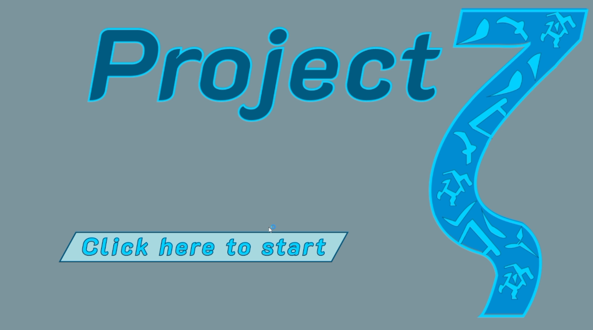
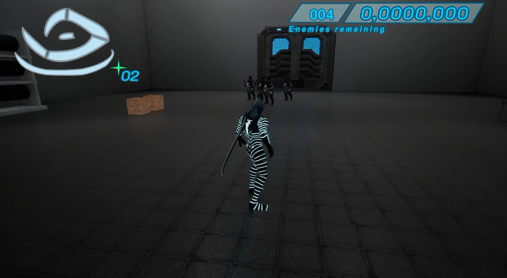
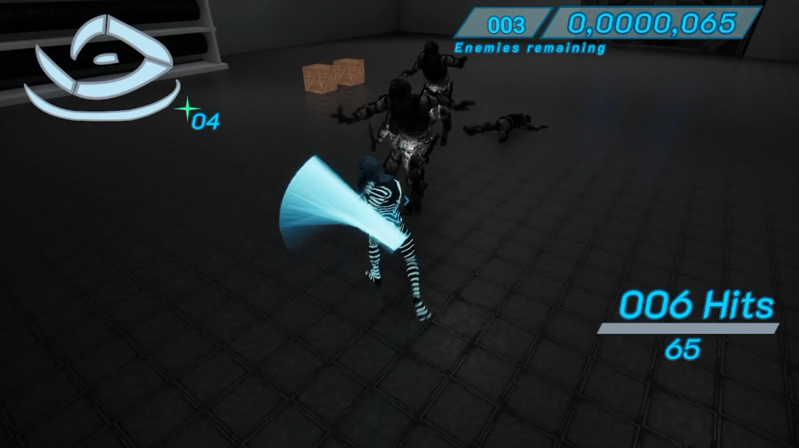
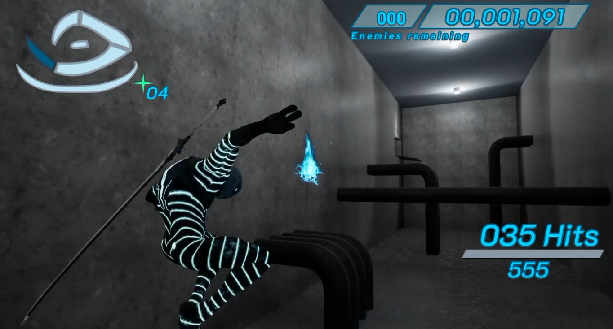
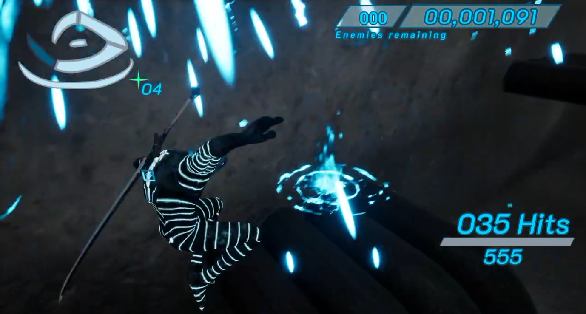
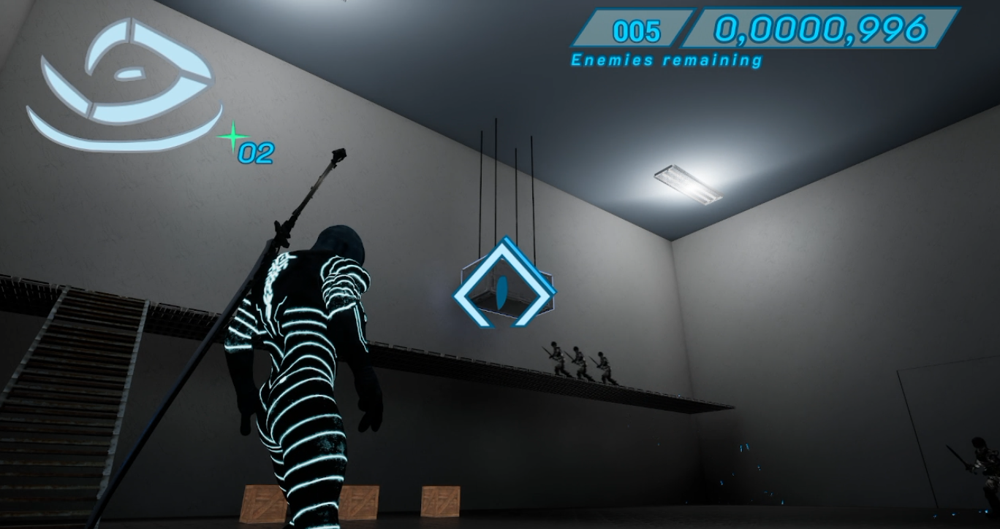
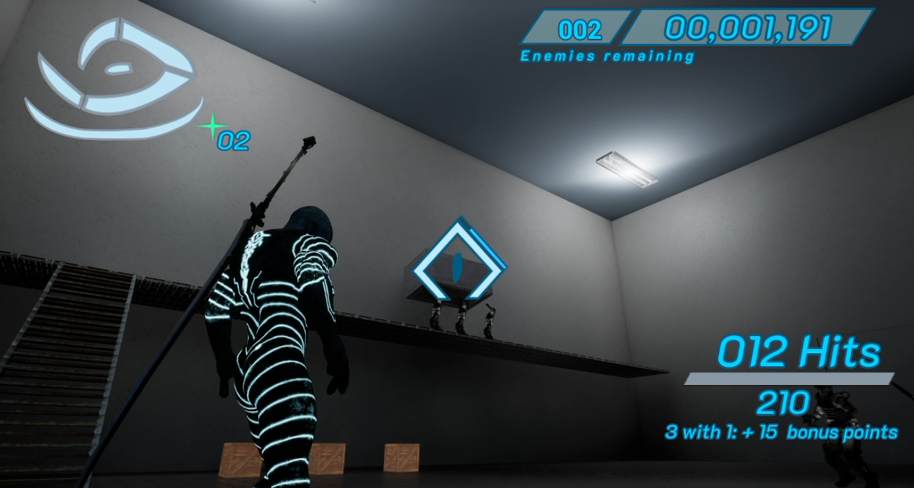
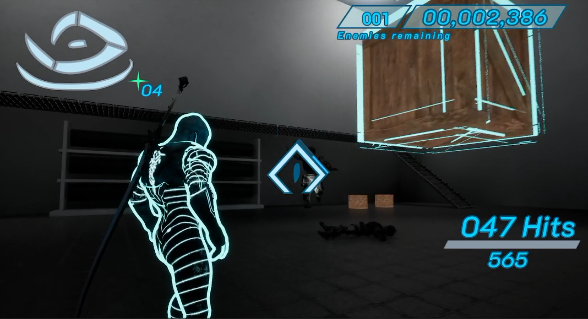
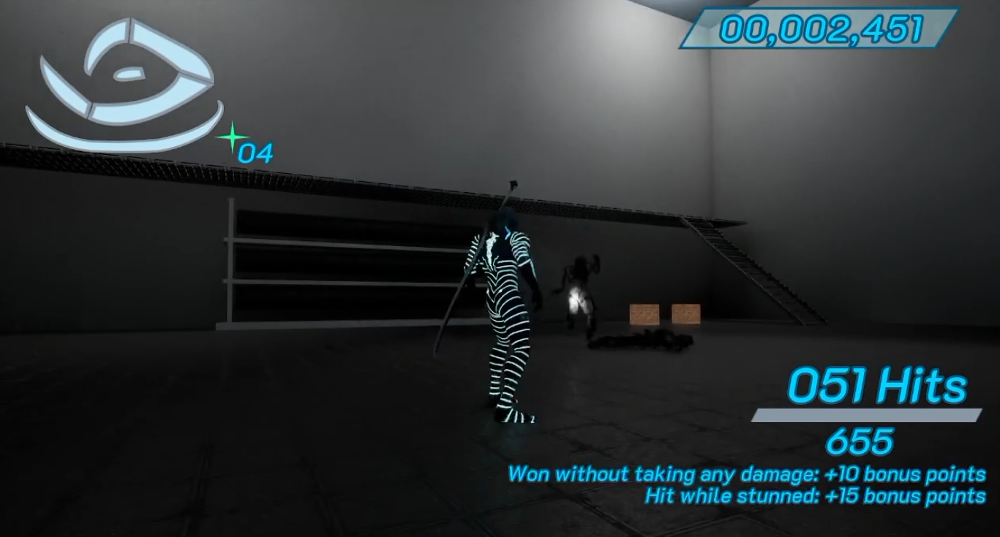
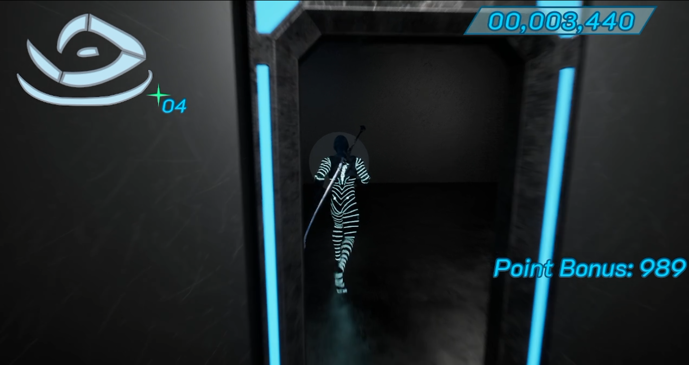
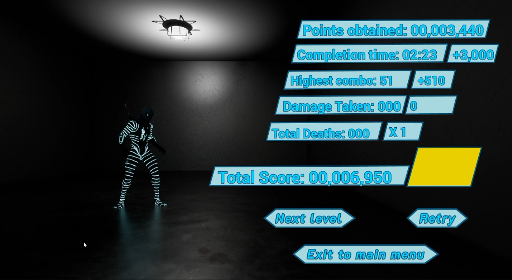
